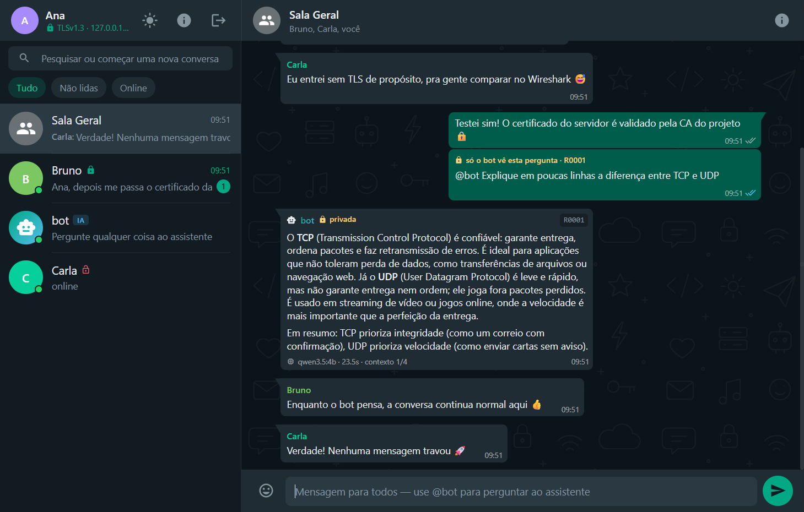

# SD Chat — sockets, threads, TLS e bot com LLM

Trabalho prático de **Sistemas Distribuídos II** (Unimontes): chat
cliente-servidor com a **API Socket (TCP)**, **threads**, **TLS** e um **bot
com LLM local** (Qwen 3.5 4B quantizado, via Ollama).



| Componente | Tecnologia | Onde |
|---|---|---|
| Servidor + interface gráfica (painel web ao vivo) | Python 3 (`socket`, `ssl`, `threading`) + HTML/CSS/JS | [`server/`](server/) |
| Cliente humano (interface estilo WhatsApp) | Electron + JavaScript (`net`/`tls` do Node.js) | [`client/`](client/) |
| Cliente bot | Python 3 + Ollama (`qwen3.5:4b`, Q4_K_M) | [`bot/`](bot/) |
| Protocolo e socket seguro para threads (compartilhados) | Python | [`common/`](common/) |

Documentação: [Protocolo](docs/PROTOCOLO.md) · [Relatório (base)](docs/RELATORIO.md) ·
[Roteiro do Wireshark](docs/WIRESHARK.md)

---

## 1. Pré-requisitos

- **Python 3.10+** (servidor e bot usam só a biblioteca padrão)
- **Node.js 18+** e npm (cliente Electron)
- **Ollama** com o modelo: `ollama pull qwen3.5:4b`
- (para a entrega) **Wireshark** com Npcap e captura de loopback

## 2. Instalação

```bash
pip install -r requirements.txt     # só "cryptography", usada para gerar os certificados
python certs/gen_certs.py           # cria a CA de teste e o certificado do servidor
cd client && npm install            # baixa o Electron
```

> Para conectar de outra máquina, gere o certificado com o IP do servidor:
> `python certs/gen_certs.py --san 192.168.0.10` e copie **apenas** `certs/ca.crt` para os clientes.

## 3. Execução

### Tudo de uma vez (Windows)

Clique duas vezes em **`demo.bat`**. Ele abre o servidor (e o painel no
navegador), o bot e três clientes: **Ana** e **Bruno** com TLS e **Carla** sem
criptografia (referência para o Wireshark).

### Manualmente (qualquer sistema)

```bash
# terminal 1 — servidor (abre o painel em http://127.0.0.1:8080)
python server/server.py

# terminal 2 — bot (Ollama precisa estar rodando)
python bot/bot.py

# terminais 3, 4, 5 — clientes humanos
cd client
npm start -- --name=Ana
npm start -- --name=Bruno
npm start -- --name=Carla --plain        # sem TLS, porta 5000
```

Sem argumentos, o cliente abre a tela de login (nome, servidor, porta e chave TLS).

### Opções

**Servidor** (`python server/server.py --help`)

| Opção | Padrão | Descrição |
|---|---|---|
| `--host` | `127.0.0.1` | use `0.0.0.0` para aceitar outras máquinas |
| `--tls-port` / `--plain-port` | `5443` / `5000` | portas com e sem TLS (`0` desativa) |
| `--dashboard-port` | `8080` | painel web (só localhost) |
| `--request-timeout` | `200` | segundos para o bot responder antes do `TIMEOUT` |
| `--idle-timeout` | `90` | desconecta clientes sem tráfego |
| `--bot-token` | `dev-bot-token` | token exigido do bot (ou variável `CHAT_BOT_TOKEN`) |
| `--no-browser` | — | não abre o painel automaticamente |

**Bot** (`python bot/bot.py --help`)

| Opção | Padrão | Descrição |
|---|---|---|
| `--model` | `qwen3.5:4b` | modelo do Ollama |
| `--ollama` | `http://127.0.0.1:11434` | URL do Ollama |
| `--llm-timeout` | `90` | segundos sem receber dados da LLM até falhar |
| `--llm-max-time` | `180` | duração máxima de uma resposta |
| `--history` | `4` | turnos (pergunta+resposta) lembrados por usuário |
| `--workers` | `4` | threads que processam perguntas em paralelo |
| `--plain` | — | conecta sem TLS (porta 5000) |

Comandos no terminal do bot: `status`, `timeout <seg>`, `modelo <nome>`,
`reset <usuário>`, `sair`.

**Cliente**: `--name=`, `--host=`, `--port=`, `--plain`, `--ca=caminho/ca.crt`,
`--autoconnect`, `--theme=dark|light`.

## 4. Usando o chat

- **Sala Geral**: mensagem para todos. Clique em um contato para conversar em particular.
- **Bot**: escreva `@bot sua pergunta` em qualquer conversa ou fale direto
  com o contato **bot**. A resposta é **privada** e chega em tempo real.
- `@bot /reset` apaga seu histórico com o bot; `@bot /ajuda` lista os comandos.
- Formatação: `*negrito*`, `_itálico_`, `~riscado~`, `` `código` ``.
- Ícone ⓘ: detalhes da conexão (TLS, certificado, SHA-256) e os últimos quadros do protocolo.

## 5. Roteiro da demonstração (seção 8 do enunciado)

| Cenário | Como mostrar |
|---|---|
| 3 humanos + 1 bot, comunicação simultânea | `demo.bat`; Ana, Bruno e Carla conversam na Sala Geral e em privado |
| Interface do servidor | painel `http://127.0.0.1:8080`: participantes, enlaces, mensagens, eventos, solicitações e **threads** |
| Solicitação à LLM e resposta | Ana: `@bot explique a diferença entre TCP e UDP` |
| Outros continuam conversando | enquanto o bot "digita", Bruno e Carla trocam mensagens normalmente |
| Pergunta de continuação | Ana: `@bot e qual dos dois é mais rápido?` (o selo mostra *contexto 1/4, 2/4…*) |
| Contextos separados | Bruno faz a mesma continuação → o bot não conhece o contexto da Ana |
| Desconexão | feche a janela da Carla (ou *Desconectar* no painel) → todos recebem a saída |
| Falha / tempo limite da LLM | no terminal do bot: `timeout 1` e pergunte algo → *Falha na consulta (LLM_TIMEOUT)*; ou pare o Ollama → *LLM_UNAVAILABLE*; ou feche o bot → *BOT_OFFLINE* |
| Criptografia | cadeados no cliente e no painel + [roteiro do Wireshark](docs/WIRESHARK.md) (porta 5000 × 5443) |

## 6. Testes

```bash
python tests/test_integration.py
```

Sobe servidor e bot reais com um Ollama **simulado** e executa 51 verificações
(conexões, TLS, roteamento, delimitação, bot, histórico, timeouts,
desconexões e painel). Resultado esperado: `51/51 verificações passaram.`

## 7. Estrutura

```
server/server.py          servidor TCP/TLS com threads + API do painel
server/dashboard/         interface gráfica do servidor (HTML/CSS/JS, SSE)
bot/bot.py                cliente bot (socket TLS + pool de threads + Ollama)
client/main.js            cliente: socket net/tls, delimitação, heartbeat
client/renderer/          interface estilo WhatsApp
common/protocol.py        protocolo: tipos, codificação e leitura de quadros
common/transport.py       SafeSocket: TLS seguro com várias threads
certs/gen_certs.py        gera a CA de teste e o certificado do servidor
tests/                    teste de integração + Ollama simulado
docs/                     protocolo, relatório-base, Wireshark e capturas
```

## 8. Problemas comuns

| Sintoma | Solução |
|---|---|
| `não foi possível carregar o certificado TLS` | rode `python certs/gen_certs.py` |
| Cliente: *certificado não é válido para este endereço* | gere de novo com `--san <ip-do-servidor>` e copie o novo `ca.crt` |
| Bot: *Ollama inacessível* / *modelo não encontrado* | inicie o Ollama e rode `ollama pull qwen3.5:4b` |
| Respostas do bot lentas | normal em CPU (~8 tokens/s); a resposta aparece em streaming |
| Electron abre como Node / `app` indefinido | use `npm start` (o `launch.js` remove `ELECTRON_RUN_AS_NODE`) |
| Porta em uso | `--tls-port`, `--plain-port`, `--dashboard-port` |

> Nenhuma credencial real é usada: o token do bot e os certificados são
> apenas de teste. As chaves privadas (`certs/*.key`) não devem ser entregues
> nem versionadas — gere-as em cada máquina.
