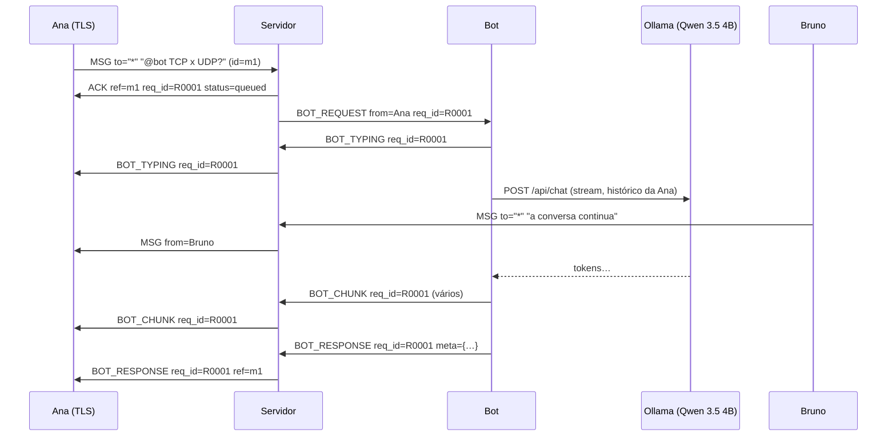

# Protocolo de aplicação do SD Chat

Versão 1 · usado igualmente pelo servidor (Python), pelo bot (Python) e pelo
cliente humano (Electron/Node.js). Implementação de referência:
[`common/protocol.py`](../common/protocol.py) (Python) e
[`client/src/main/framing.js`](../client/src/main/framing.js) (Node.js).

## 1. Transporte e delimitação

| Item | Definição |
|---|---|
| Transporte | TCP (API Socket), porta **5443 com TLS** ou **5000 sem criptografia** |
| Codificação | UTF-8 |
| Quadro | **um objeto JSON por linha**, terminado por `\n` (byte `0x0A`) — formato NDJSON |
| Tamanho máximo | 64 KiB por quadro (texto da mensagem: até 4000 caracteres) |
| Ordem | garantida pelo TCP; o servidor usa uma fila FIFO por destinatário |

**Por que `\n` é um delimitador seguro:** o JSON obriga a escapar quebras de
linha dentro de strings (`"linha1\nlinha2"` vira os caracteres `\` e `n`).
Logo, o byte `0x0A` só aparece entre quadros.

**Leitura de um fluxo TCP:** um `recv()` pode trazer meio quadro ou vários
quadros juntos. Os bytes vão para um buffer; cada `\n` encontrado fecha um
quadro completo, e o que sobra continua no buffer até a próxima leitura
(`FrameReader` no Python, `ChatConnection._onData` no Node). Se o buffer passa
de 64 KiB sem um `\n`, a conexão é encerrada (proteção contra abuso). JSON
inválido gera `ERROR` com código `BAD_FRAME`, mas a conexão continua.

## 2. Campos de um quadro

| Campo | Tipo | Obrigatório | Descrição |
|---|---|---|---|
| `type` | string | sim | tipo da mensagem (tabela da seção 3) |
| `id` | string | sim | identificador único do quadro, gerado por quem envia |
| `from` | string | sim | **remetente**. Nos quadros vindos de clientes, o servidor **ignora** o valor enviado e usa o nome autenticado da conexão (impede falsificação) |
| `to` | string | sim | **destinatário**: nome do usuário, `"*"` (todos/Sala Geral), nome do bot ou `"server"` |
| `content` | string/objeto | depende | **conteúdo**: texto da mensagem ou objeto (ex.: lista de usuários) |
| `req_id` | string | nas mensagens do bot | **identificador da solicitação** ao bot (`R0001`, `R0002`...), criado pelo servidor |
| `ref` | string | em respostas | `id` do quadro ao qual este responde (ACK, ERROR, WELCOME, respostas do bot) |
| `ts` | número | sim | instante do envio (ms desde 1970) |
| `code` | string | em erros | código de erro legível por máquina |
| `meta` | objeto | `BOT_RESPONSE` | modelo, tempo de resposta, turnos de histórico usados e limite |

Exemplo (mensagem pública vista pelo destinatário):

```json
{"type":"MSG","id":"6f1c2a9e0b11","from":"Ana","to":"*","content":"Olá, pessoal!","ts":1794390012345}
```

## 3. Tipos de mensagem

### Cliente → servidor

| Tipo | `to` | `content` | Efeito |
|---|---|---|---|
| `HELLO` | `server` | `{role: "human"\|"bot", client, token?}` | identificação; **deve ser o primeiro quadro**. Bots precisam do `token` |
| `MSG` | `*`, usuário ou bot | texto | mensagem pública, privada ou pergunta ao bot |
| `TYPING` | `*` ou usuário | `true`/`false` | indicador "digitando…" |
| `LIST` | `server` | — | pede a lista de usuários |
| `PING` | `server` | — | heartbeat (a cada 25 s); o servidor responde `PONG` |
| `BYE` | `server` | — | saída voluntária |

### Servidor → cliente

| Tipo | Quando |
|---|---|
| `WELCOME` | `HELLO` aceito; `content` traz nome, papel, se o enlace é seguro, dados do TLS e a lista de usuários |
| `ACK` | mensagem processada: `{status: "delivered", recipients: n}` ou `{status: "queued", bot}` + `req_id` quando vira solicitação ao bot |
| `MSG` | mensagem encaminhada de outro usuário |
| `USER_JOINED` / `USER_LEFT` | entrada e saída de participantes (com motivo da saída) |
| `USER_LIST` | resposta a `LIST` |
| `TYPING` | repasse do indicador de digitação |
| `SYSTEM` | aviso do administrador (painel) ou do servidor (ex.: desligamento) |
| `ERROR` | erro com `code` e `ref` (ver seção 6) |
| `PONG` | resposta ao `PING` |

### Servidor ↔ bot

| Tipo | Sentido | Descrição |
|---|---|---|
| `BOT_REQUEST` | servidor → bot | pergunta: `from` = usuário, `req_id`, `content` = pergunta sem a menção |
| `BOT_CANCEL` | servidor → bot | solicitação expirou ou o usuário saiu; o bot interrompe a geração |
| `BOT_TYPING` | bot → servidor → usuário | o bot começou a consultar a LLM |
| `BOT_CHUNK` | bot → servidor → usuário | pedaço da resposta (streaming, a cada ~150 ms) |
| `BOT_RESPONSE` | bot → servidor → usuário | resposta completa + `meta` |
| `BOT_ERROR` | bot/servidor → usuário | falha (`LLM_TIMEOUT`, `LLM_UNAVAILABLE`, `TIMEOUT`, `BOT_OFFLINE`...) |

## 4. Acionamento e correlação do bot

O bot é acionado de duas formas:

1. **Menção**: uma `MSG` cujo texto começa com `@bot` (em qualquer conversa).
   Exemplo: `@bot explique a diferença entre TCP e UDP`.
2. **Conversa direta**: uma `MSG` com `to` igual ao nome do bot.

Uma pergunta ao bot **nunca é retransmitida aos outros usuários**. O servidor:

1. cria o `req_id` sequencial (`R0001`) e registra a solicitação pendente
   `{req_id, usuário, bot, pergunta, ref, criada_em}` sob lock;
2. responde `ACK {status: "queued"}` ao usuário com o `req_id` e `ref` = id da mensagem;
3. envia `BOT_REQUEST` ao bot.

Quando chega `BOT_TYPING`, `BOT_CHUNK`, `BOT_RESPONSE` ou `BOT_ERROR`, o
servidor procura o `req_id` na tabela de pendentes e **usa o usuário
registrado ali como destinatário**, ignorando o `to` informado pelo bot.
Respostas com `req_id` desconhecido (expirado, cancelado ou inventado) são
descartadas. Isso garante a **privacidade** (só quem perguntou recebe) e a
**correlação correta**, mesmo com várias perguntas simultâneas.

### Sequência: Ana pergunta ao bot enquanto Bruno conversa



### Exemplo de troca (ids e textos abreviados com `…`)

```json
{"type":"MSG","id":"a1b2c3d4e5f6","from":"Carla","to":"*","content":"@bot o que é uma thread?","ts":1794390074000}
{"type":"ACK","id":"0c9d…","from":"server","to":"Carla","content":{"status":"queued","bot":"bot"},"ts":1794390074003,"req_id":"R0002","ref":"a1b2c3d4e5f6"}
{"type":"BOT_REQUEST","id":"77aa…","from":"Carla","to":"bot","content":"o que é uma thread?","ts":1794390074003,"req_id":"R0002","ref":"a1b2c3d4e5f6"}
{"type":"BOT_CHUNK","id":"…","from":"bot","to":"Carla","content":"Uma thread é um fluxo","ts":…,"req_id":"R0002","ref":"a1b2c3d4e5f6"}
{"type":"BOT_RESPONSE","id":"…","from":"bot","to":"Carla","content":"Uma thread é um fluxo de execução…","ts":…,"req_id":"R0002","ref":"a1b2c3d4e5f6","meta":{"model":"qwen3.5:4b","elapsed_s":12.2,"history_turns":1,"history_limit":4}}
```

## 5. Ciclo de vida da conexão

```
cliente                      servidor
  | --- TCP SYN/ACK -------->  |  thread aceitadora cria a ClientConnection
  | <== handshake TLS 1.3 ==>  |  (na thread da própria conexão; porta 5443)
  | --- HELLO --------------->  |  valida nome (regex, reservado, duplicado) e token do bot
  | <-- WELCOME / ERROR ------  |  ERROR => conexão encerrada após o envio
  | <-> MSG / ACK / TYPING ...  |
  | --- PING (25 s) --------->  |  sem tráfego por 90 s => desconexão por inatividade
  | --- BYE ou queda -------->  |  remove da tabela, avisa todos com USER_LEFT,
  |                            |  cancela/falha solicitações pendentes ao bot
```

Regras de nome: 2 a 20 caracteres (letras, inclusive acentuadas, números, `.`,
`_`, `-`), sem distinguir maiúsculas de minúsculas; nomes reservados:
`server`, `servidor`, `todos`, `all`, `admin`.

## 6. Códigos de erro

| Código | Tipo | Significado |
|---|---|---|
| `HELLO_REQUIRED` | ERROR | o primeiro quadro não foi `HELLO` |
| `BAD_NAME` / `NAME_TAKEN` | ERROR | nome inválido / já em uso |
| `BAD_ROLE` / `BAD_TOKEN` | ERROR | papel inválido / token do bot incorreto |
| `BAD_FRAME` | ERROR | JSON inválido (a conexão continua) |
| `BAD_TYPE` | ERROR | tipo não permitido para o papel da conexão |
| `EMPTY` / `TOO_LONG` | ERROR | mensagem vazia / acima de 4000 caracteres |
| `USER_NOT_FOUND` | ERROR | destinatário não está online |
| `TOO_MANY_REQUESTS` | ERROR | mais de 3 perguntas simultâneas ao bot pelo mesmo usuário |
| `BOT_OFFLINE` | BOT_ERROR | nenhum bot conectado, ou o bot caiu antes de responder |
| `TIMEOUT` | BOT_ERROR | o servidor não recebeu resposta do bot no tempo limite (padrão 200 s) |
| `LLM_TIMEOUT` | BOT_ERROR | a LLM ficou mais que `--llm-timeout` segundos sem enviar dados |
| `LLM_UNAVAILABLE` | BOT_ERROR | Ollama fora do ar, modelo inexistente ou erro HTTP |
| `INTERNAL` | BOT_ERROR | exceção inesperada no bot |
| `KICKED` / `SHUTDOWN` | SYSTEM | removido pelo administrador / servidor encerrando |
