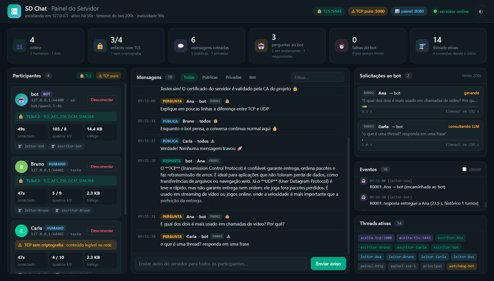
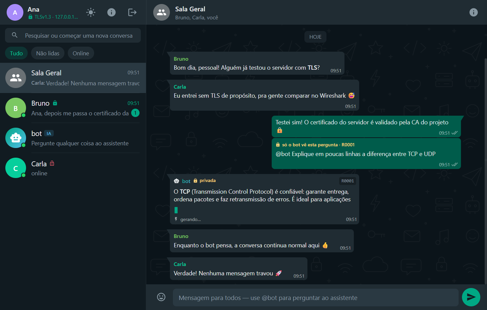
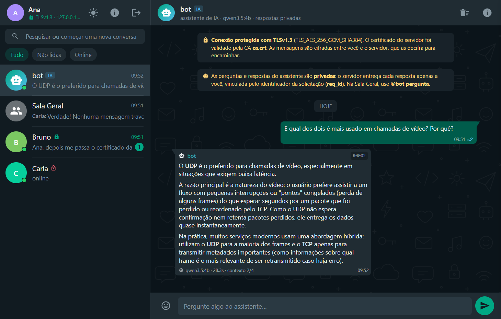
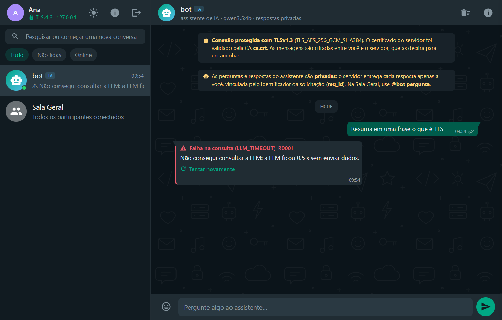

# SD Chat — Chat cliente-servidor com sockets, threads, TLS e bot com LLM

**Universidade Estadual de Montes Claros — Sistemas Distribuídos II**
Engenharia de Sistemas · 6º período · Prof. Marcel Veloso Campos

**Acadêmicos:** _(preencher)_ · **Data:** _(preencher)_ · **Vídeo:** _(link da gravação)_

---

## 1. Visão geral

O SD Chat é uma aplicação de mensagens com três componentes que se comunicam
**exclusivamente por sockets TCP** implementados diretamente com a API Socket:

| Componente | Tecnologia | Papel |
|---|---|---|
| **Servidor** (pacote `server/`) | Python 3 — `socket`, `ssl`, `threading` | aceita conexões, identifica participantes, roteia mensagens, intermedeia o bot e apresenta a **interface gráfica** (painel web em tempo real) |
| **Cliente humano** (`client/`) | Electron + JavaScript — módulos `net`/`tls` do Node.js | interface no estilo WhatsApp; envia/recebe sem bloquear a digitação |
| **Cliente bot** (pacote `bot/`) | Python 3 — `socket`, `ssl`, `ThreadPoolExecutor`, `urllib` | processo separado que se conecta ao servidor por socket, identifica-se como bot e responde usando a LLM **Qwen 3.5 4B quantizada (Q4_K_M)** executada localmente no Ollama |

```
 ┌──────────────┐  TLS :5443   ┌─────────────────────────────┐   TLS :5443  ┌───────────────┐  HTTP   ┌──────────────┐
 │ Ana (Electron)│◄────────────►│                             │◄────────────►│ Bot (Python)  │◄──────►│ Ollama       │
 └──────────────┘               │    Servidor (Python)        │              │ pool de threads│ :11434 │ qwen3.5:4b   │
 ┌──────────────┐  TLS :5443   │  thread por conexão         │              └───────────────┘        │ Q4_K_M (CPU) │
 │Bruno(Electron)│◄────────────►│  leitora + escritora        │                                       └──────────────┘
 └──────────────┘               │  watchdog · painel (SSE)    │──► http://127.0.0.1:8080 (GUI do servidor)
 ┌──────────────┐  TCP :5000   │                             │
 │Carla(Electron)│◄────────────►│ (porta sem TLS = referência)│
 └──────────────┘               └─────────────────────────────┘
```

A chamada HTTP do bot ao Ollama usa biblioteca pronta (`urllib`), como o
enunciado permite; ela **complementa** o bot e não substitui o socket entre
os componentes do chat.

### 1.1 Organização do código

O código segue os princípios SOLID: cada módulo tem uma responsabilidade e as
peças dependem de interfaces pequenas, não de classes concretas.

| Princípio | Onde aparece |
|---|---|
| **Responsabilidade única** | o servidor é dividido em `connection` (threads de um socket), `registry` (participantes), `sessions` (entrada/saída), `router` (roteamento), `bot_broker` (solicitações ao bot), `listener` (aceitação) e `dashboard` (interface gráfica); o bot, em `connection`, `assistant`, `llm`, `history`, `commands` e `console`; a interface do cliente, em módulos de estado, visões, envio e tratamento de quadros |
| **Aberto/fechado** | o roteador do servidor, o despacho do bot e o tratamento de quadros no cliente usam **tabelas de tratadores por tipo**: um tipo novo de mensagem é uma entrada nova, sem alterar o código existente; comandos do bot (`/reset`, `/ajuda`) e do console também são registrados |
| **Substituição de Liskov** | qualquer implementação de `ChatModel` (Ollama real ou modelo falso dos testes) funciona no `Assistant`; o `SafeSocket` mantém a interface de socket usada pelo `FrameReader` |
| **Segregação de interfaces** | `ConnectionHandler` (o que a conexão notifica: HELLO, quadro, fechamento) e `AdminService` (o que o painel pode fazer) são interfaces mínimas |
| **Inversão de dependência** | a `ClientConnection` não conhece o roteamento, o `Assistant` não conhece o Ollama nem sockets, o painel não conhece threads; as classes concretas são criadas apenas nas **raízes de composição** (`server/cli.py`, `bot/cli.py`, `client/main.js`) |

Essa separação permitiu testar o roteamento, a correlação por `req_id` e o
histórico do bot **sem abrir sockets** (seção 8).

## 2. Protocolo de aplicação

Especificação completa: [PROTOCOLO.md](PROTOCOLO.md). Resumo:

- **Delimitação:** um objeto JSON UTF-8 por linha, terminado por `\n`
  (NDJSON). O JSON escapa quebras de linha nas strings, então `\n` só aparece
  entre quadros. Máximo de 64 KiB por quadro.
- **Campos exigidos pelo enunciado:** remetente (`from`), destinatário (`to`),
  tipo (`type`), conteúdo (`content`) e identificador da solicitação
  (`req_id`), além de `id`, `ref` (correlação de ACK/erros) e `ts`.
- **Tipos:** `HELLO`, `WELCOME`, `MSG`, `ACK`, `TYPING`, `PING`/`PONG`, `BYE`,
  `USER_JOINED`, `USER_LEFT`, `USER_LIST`, `SYSTEM`, `ERROR`, e para o bot
  `BOT_REQUEST`, `BOT_TYPING`, `BOT_CHUNK`, `BOT_RESPONSE`, `BOT_ERROR`, `BOT_CANCEL`.
- **Encaminhamento:** `to="*"` → todos os humanos (Sala Geral); `to=<nome>` →
  mensagem privada; `@bot …` ou `to=bot` → solicitação ao bot (nunca
  retransmitida aos demais).
- **Segurança do protocolo:** o servidor sobrescreve `from` com o nome
  autenticado da conexão (sem falsificação de remetente), valida nomes,
  exige token do bot e limita tamanho de quadros e de mensagens.

## 3. Uso de threads e concorrência

### 3.1 Servidor — uma thread por conexão (leitora) + uma escritora

| Thread | Quantidade | Função |
|---|---|---|
| `principal` | 1 | inicia tudo e trata o Ctrl+C |
| `aceita-tls:5443`, `aceita-tcp:5000` | 1 por porta | laço `accept()`; para cada conexão cria uma `ClientConnection` e sua thread |
| `leitor-<nome>` | 1 por cliente | handshake TLS, `HELLO`, leitura e delimitação dos quadros, roteamento |
| `escritor-<nome>` | 1 por cliente | consome a **fila de saída** (`queue.Queue`) do cliente e faz `sendall` |
| `watchdog-bot` | 1 | a cada 0,5 s expira solicitações ao bot que passaram do tempo limite |
| `painel-http`, `painel-sse-N` | 1 + 1 por aba aberta | servidor HTTP do painel e fluxo de eventos ao vivo |

Decisões importantes:

- **Handshake TLS na thread da conexão**, não na aceitadora: um cliente lento
  ou malicioso não impede que outros se conectem.
- **Fila de saída por cliente:** quem roteia uma mensagem apenas *enfileira*
  (`put_nowait`, nunca bloqueia). Um cliente lento só atrasa a própria fila;
  se ela encher (2000 quadros) ou o envio travar por 30 s, só aquela conexão
  é encerrada. Isso garante que *“os demais usuários continuam conversando
  durante o processamento”*.
- O painel mostra a lista de threads ativas em tempo real (ex.: 14 threads
  com 3 humanos + 1 bot + painel aberto).

### 3.2 Sincronização das estruturas compartilhadas

| Estrutura | Proteção | Observação |
|---|---|---|
| `clients` (nome → conexão), `connections`, `pending` (solicitações ao bot) | `threading.RLock` | regra: **nunca fazer I/O de rede com o lock**; dentro dele só se copia a lista de destinatários |
| registro de nome no `HELLO` | verificação + inserção **no mesmo bloco `with lock`** | evita a condição de corrida de dois clientes registrarem o mesmo nome ao mesmo tempo |
| estatísticas | `threading.Lock` próprio | contadores do painel |
| filas de saída | `queue.Queue` (thread-safe) | produtor: qualquer thread; consumidor: a escritora |
| socket TLS compartilhado por leitora e escritora | **`SafeSocket`** ([common/transport.py](../common/transport.py)) | ver 3.3 |

### 3.3 Problema encontrado: OpenSSL não é thread-safe por objeto

Nos testes de estresse, ~3% das conexões TLS falhavam (`WinError 10053`). A
causa: a thread leitora (processando um *NewSessionTicket* do TLS 1.3) e
outra thread (enviando o `HELLO`) usavam **o mesmo objeto SSL ao mesmo
tempo**, o que o OpenSSL não permite. A solução foi o `SafeSocket`: o socket
fica em modo **não bloqueante**; cada `recv`/`send` é feito **com um lock**
(que fica preso por microssegundos, já que a chamada não bloqueia) e a
**espera** por dados ou por espaço no buffer acontece **fora do lock**, com
`select()`. Assim a leitora pode aguardar indefinidamente sem impedir que
outras threads enviem. Resultado: **0 falhas em 300 conexões** (antes, 12/300)
e **8.400 entregas sem perda nem desordem** em 0,31 s com 8 clientes enviando
ao mesmo tempo.

### 3.4 Clientes humanos — operação assíncrona

O cliente Electron separa interface e rede em processos diferentes. O
**processo principal** (Node.js) é o dono do socket: os dados chegam por
eventos (`'data'`, `'close'`, `'error'`) no laço de eventos, sem bloquear. A
**interface** (renderer) roda em outro processo e conversa com o principal
por IPC. Por isso a digitação nunca trava, mesmo enquanto chegam respostas do
bot em streaming.

### 3.5 Bot — pool de threads

A thread `leitor-socket` só lê quadros e entrega cada `BOT_REQUEST` a um
`ThreadPoolExecutor` (`llm-worker_0..3`). Assim o bot atende vários usuários
em paralelo (nos testes, as perguntas da Ana e da Carla foram processadas
simultaneamente por `llm-worker_0` e `llm-worker_1`). Um **lock por usuário**
faz com que perguntas do *mesmo* usuário sejam respondidas em ordem (o
histórico fica consistente), enquanto usuários diferentes não se bloqueiam.
Outras threads: `heartbeat` (PING a cada 25 s) e `console` (comandos no
terminal do bot).

### 3.6 Entradas, saídas e falhas de conexão

- **Saída voluntária:** `BYE` → remoção da tabela → `USER_LEFT` a todos.
- **Queda abrupta** (processo morto, rede caiu): `recv` retorna erro/EOF →
  mesma limpeza, com o motivo (*“conexão interrompida sem aviso”*).
- **Cliente inativo:** sem nenhum quadro por 90 s (o cliente manda `PING` a
  cada 25 s) → desconexão por inatividade.
- **Usuário sai com pergunta pendente:** o servidor envia `BOT_CANCEL` e o
  bot interrompe a geração; o bot também descarta o histórico daquele usuário.
- **Bot cai:** cada usuário com pergunta pendente recebe `BOT_ERROR BOT_OFFLINE`.
- **Bot não responde:** o `watchdog-bot` envia `BOT_ERROR TIMEOUT` ao usuário
  e `BOT_CANCEL` ao bot após o tempo limite (200 s, configurável).
- **Cliente:** mostra um banner *“Conexão com o servidor perdida”* com o
  botão **Reconectar**; mensagens não confirmadas ficam marcadas com erro.
- **Administrador:** pode desconectar um participante pelo painel.

## 4. Interface gráfica do servidor

Ao iniciar, o servidor abre `http://127.0.0.1:8080` (somente localhost). A
página recebe o estado por **Server-Sent Events** e se atualiza sozinha:

- **Topo:** portas (🔒 TLS :5443, ⚠ TCP :5000), tempo no ar, tempos limite.
- **Indicadores:** participantes online, enlaces com TLS, mensagens roteadas,
  perguntas ao bot (em andamento/respondidas), falhas e timeouts, threads ativas.
- **Participantes:** nome, papel (humano/bot), endereço e porta de origem,
  **tipo de enlace (TLS 1.3 + cifra, ou TCP sem criptografia)**, tempo
  conectado, quadros e bytes, **threads da conexão** e botão *Desconectar*.
- **Mensagens:** todas as mensagens roteadas (públicas, privadas, perguntas,
  respostas e falhas do bot) com remetente → destinatário, `req_id` e
  filtros; campo para **enviar aviso** a todos.
- **Solicitações ao bot:** cada `req_id` pendente com usuário, pergunta,
  estado (*na fila / consultando LLM / gerando*) e barra de progresso até o
  tempo limite.
- **Eventos:** conexões, handshakes TLS, entradas/saídas com motivo,
  timeouts e erros — cada um com a **thread** que o gerou.
- **Threads ativas:** lista em tempo real, colorida por função.



## 5. Interface do cliente humano

Inspirada no WhatsApp Desktop (temas escuro e claro): lista de conversas com
prévia, horário e não lidas; **Sala Geral**, conversas privadas e conversa com
o **bot**; indicador *digitando…*; confirmações ✓ (enviada), ✓✓ (entregue pelo
servidor) e ✓✓ azul (o bot respondeu); formatação `*negrito*`, `_itálico_`,
`` `código` ``; respostas do bot em Markdown, **em tempo real (streaming)**,
com `req_id`, modelo, tempo e uso do histórico; botão *Tentar novamente* em
falhas; cadeado em cada contato indicando se o enlace dele usa TLS; gaveta
**Conexão e protocolo** com detalhes do certificado e os últimos quadros
trocados.



## 6. Criptografia

### 6.1 Mecanismo

**TLS 1.3** (mínimo aceito: TLS 1.2) sobre os sockets TCP, com as
bibliotecas consolidadas `ssl` (OpenSSL, no Python) e `tls` (Node.js). Suíte
negociada nos testes: **TLS_AES_256_GCM_SHA384** (cifra autenticada
AES-256-GCM), troca de chaves efêmera **ECDHE/X25519** (*forward secrecy*).

### 6.2 Chaves e certificados (`certs/gen_certs.py`)

1. É criada uma **CA de teste** própria (`ca.key`/`ca.crt`, ECDSA P-256,
   válida por 1 ano, `BasicConstraints CA=true`).
2. É gerado o par do servidor (`server.key`) e o certificado `server.crt`
   **assinado pela CA**, com `CN=localhost`, `ExtendedKeyUsage=serverAuth` e
   **SAN** contendo `localhost`, `127.0.0.1`, `::1`, o nome da máquina e os IPs
   locais (outros com `--san`).
3. O servidor carrega `server.crt` + `server.key`; os clientes recebem
   **apenas** `ca.crt`. As chaves privadas não são distribuídas (estão no
   `.gitignore`).

### 6.3 Procedimento de validação

O cliente **valida explicitamente** o servidor, como exige o enunciado:

- **Electron:** `tls.connect({ ca: ca.crt, rejectUnauthorized: true, minVersion: 'TLSv1.2' })`
  — confia só na CA do projeto, verifica a cadeia, a validade e se o
  endereço acessado está no SAN.
- **Bot:** `ssl.create_default_context(cafile=ca.crt)` com
  `check_hostname=True` e `server_hostname=host`.
- **Teste negativo:** um cliente que confia apenas nas CAs do sistema recusa o
  servidor (`unable to get local issuer certificate`) — verificado no teste
  automatizado. A gaveta *Conexão e protocolo* mostra CN, emissor, SAN,
  validade e impressão digital SHA-256 do certificado validado.

### 6.4 Enlaces protegidos e onde ocorre a decifragem

| Enlace | Porta | Protegido |
|---|---|---|
| Cliente humano ↔ servidor (Ana, Bruno) | 5443 | **sim (TLS 1.3)** |
| Bot ↔ servidor | 5443 | **sim (TLS 1.3)** |
| Cliente humano ↔ servidor (Carla, referência) | 5000 | não — usado só para a comparação no Wireshark |
| Bot ↔ Ollama | 11434 (localhost) | não — HTTP local na mesma máquina, não passa pela rede |
| Navegador ↔ painel | 8080 (localhost) | não — acessível apenas localmente |

A decifragem ocorre **no servidor**, na thread leitora de cada conexão, antes
da delimitação dos quadros: o servidor precisa ler `to` e detectar `@bot` para
rotear, e **cifra novamente** com a sessão TLS do destinatário. A proteção é
**por enlace**, não ponta a ponta. O cliente avisa quando o outro participante
de uma conversa privada está sem TLS.

### 6.5 Wireshark

Roteiro completo em [WIRESHARK.md](WIRESHARK.md). Na porta 5000 a mensagem
conhecida aparece legível no *Follow TCP Stream*; na porta 5443 só aparecem o
handshake e registros `Application Data` cifrados, e a busca pelo texto não
encontra nada.

> 📸 _(inserir as capturas do Wireshark: sem TLS × com TLS e a tabela de fluxos)_

## 7. Bot com LLM

| Item | Escolha |
|---|---|
| **Modelo** | **Qwen 3.5 4B** (`qwen3.5:4b`, 4,7 B parâmetros, quantização **Q4_K_M**, ~3,4 GB) |
| **Execução** | local, no **Ollama** (`http://127.0.0.1:11434/api/chat`), em CPU, com `stream: true`, `think: false` (modo de raciocínio desligado para responder mais rápido), `temperature 0.6`, `num_ctx 4096`, até 600 tokens |
| **Tema** | assistente da disciplina *Sistemas Distribuídos II* (redes, sockets, threads, TLS etc.) |
| **Acionamento** | `@bot pergunta` em qualquer conversa ou mensagem direta ao contato *bot* |
| **Identificação** | o bot se apresenta com `HELLO role=bot` + token; toda resposta leva `from=bot`, o `req_id` da solicitação e `ref` = id da pergunta |
| **Histórico** | **4 turnos (pergunta + resposta) por usuário**, em dicionários separados por nome (contextos nunca se misturam); cada texto guardado é limitado a 2000 caracteres; `@bot /reset` apaga; o histórico é descartado quando o usuário sai |
| **Tempo limite** | `--llm-timeout 90` s sem receber dados da LLM (primeiro token ou entre tokens), `--llm-max-time 180` s por resposta; no servidor, 200 s por solicitação |
| **Falhas** | `LLM_TIMEOUT`, `LLM_UNAVAILABLE` (Ollama parado/modelo ausente), `BOT_OFFLINE`, `TIMEOUT` — todas viram uma mensagem de erro com *Tentar novamente* |

**Instrução de comportamento (system prompt):**

> Você é o SD-Bot, assistente virtual da disciplina Sistemas Distribuídos II
> (Engenharia de Sistemas — Unimontes), participando de um chat em grupo.
> Responda sempre em português do Brasil, de forma clara, correta e objetiva;
> prefira respostas curtas (até ~150 palavras); use exemplos práticos e, quando
> útil, listas ou trechos curtos de código em Markdown; se não souber, diga e
> peça esclarecimento — não invente fatos; considere as mensagens anteriores
> para perguntas de continuação. Você está conversando em privado com o
> usuário "{user}".

**Percurso de uma solicitação:** Ana digita `@bot …` → o Electron envia `MSG`
pelo socket TLS → a thread `leitor-Ana` do servidor decifra, delimita e
reconhece a menção → cria `R0001` na tabela de pendentes (lock) e responde
`ACK` → enfileira `BOT_REQUEST` na fila da conexão do bot → a thread
`escritor-bot` envia → a `leitor-socket` do bot entrega ao pool → um
`llm-worker` monta *system prompt + histórico da Ana + pergunta* e chama o
Ollama → os tokens voltam como `BOT_CHUNK` → `BOT_RESPONSE` → o servidor confere
`R0001` e entrega **só** à Ana.

**Medições com o modelo real** (notebook sem GPU dedicada, Intel Iris Xe,
16 GB de RAM), em duas execuções de teste: ~7,6 tokens/s; *“diferença entre
TCP e UDP”* em 23–34 s; pergunta da Carla feita **ao mesmo tempo** que a da
Ana respondida em 12–33 s (processadas em paralelo por `llm-worker_0` e
`llm-worker_1`); pergunta de continuação da Ana (*“E qual dos dois é mais
usado em chamadas de vídeo?”*) em 28–49 s usando 2/4 turnos de contexto — o
modelo entendeu “dos dois” como TCP/UDP pelo histórico.



## 8. Testes e evidências

O projeto tem três níveis de testes, todos passando:

| Nível | Comando | O que cobre |
|---|---|---|
| Unitários (Python) | `python -m unittest discover -s tests/unit` | protocolo e delimitação, validação do HELLO, roteamento e intermediação do bot **sem sockets** (conexões falsas), histórico, comandos e agrupamento do streaming (24 testes) |
| Unitários (cliente) | `cd client && npm test` | delimitação dos quadros no Node.js, argumentos, mensagens de erro, formatação estilo WhatsApp e Markdown (10 testes) |
| Integração | `python tests/integration/test_integration.py` | sistema completo, descrito abaixo (51 verificações) |

O teste de integração sobe servidor e bot como processos separados, um Ollama
simulado (respostas determinísticas) e três clientes (dois TLS, um TCP), e faz
**51 verificações**:

- conexões TLS/TCP, lista de usuários, `USER_JOINED`, nome duplicado recusado,
  cliente sem a CA recusa o servidor;
- mensagens públicas/privadas, sem eco, sem vazamento, acentos e emojis
  intactos, **remetente falsificado ignorado**, **20 quadros num único
  `send` chegam separados e em ordem**, JSON inválido não derruba a conexão;
- bot: `req_id` criado, `BOT_TYPING`/`BOT_CHUNK`/`BOT_RESPONSE` correlacionados,
  **mensagem Bruno→Carla entregue em ~0 ms durante a consulta**, nada vaza
  para os outros usuários;
- histórico: continuação recebe a pergunta anterior, contextos separados,
  perguntas simultâneas para o usuário certo, limite de 4 turnos, `/reset`;
- falhas: `LLM_TIMEOUT`, queda abrupta de cliente (`USER_LEFT`), destinatário
  offline, queda do bot, `BOT_OFFLINE`, token de bot inválido, destinatário
  corrigido pelo servidor, `req_id` inventado descartado, **timeout do
  servidor com `BOT_CANCEL`**;
- painel: participantes, enlace TLS, threads e estatísticas.

Capturas da interface em [docs/img](img/): login, Sala Geral com resposta do
bot, concorrência, conversa privada, painel, gaveta de conexão, tema claro e
falha por tempo limite.



## 9. Limitações encontradas

- **Latência da LLM em CPU:** ~7–8 tokens/s; respostas levam de 10 a 50 s. O
  streaming e o indicador *digitando…* melhoram a percepção, e o bot processa
  usuários em paralelo, mas o Ollama divide a mesma CPU entre eles.
- **Criptografia por enlace, não ponta a ponta:** o servidor decifra para
  rotear e enxerga o conteúdo. E2E exigiria que os clientes trocassem chaves
  entre si (fora do escopo).
- **CA de teste:** certificados próprios, válidos por 1 ano; em produção
  seria necessária uma CA reconhecida e um processo de renovação/revogação.
- **Sem persistência:** histórico de conversas e do bot ficam em memória; ao
  reiniciar, tudo é perdido. O contexto do bot é descartado quando o usuário sai.
- **Sem autenticação de usuários humanos:** basta escolher um nome livre; o
  bot usa um token compartilhado simples.
- **Servidor único:** não há replicação nem balanceamento; se ele cair, o chat
  para (os clientes oferecem reconexão).
- **Thread por conexão:** simples e adequada à escala da disciplina, mas
  consome memória por cliente; milhares de conexões pediriam I/O assíncrono.
- **Painel sem senha:** protegido apenas por escutar em `127.0.0.1` e por
  exigir `Content-Type: application/json` nas ações (contra CSRF).
- **OpenSSL e threads:** foi preciso serializar o acesso ao objeto SSL
  (seção 3.3) — um detalhe pouco documentado que causava falhas intermitentes.

## 10. Execução

Instruções completas no [README](../README.md). Resumo: `pip install -r
requirements.txt`, `python certs/gen_certs.py`, `ollama pull qwen3.5:4b`,
`cd client && npm install`, e então `demo.bat` (ou os comandos manuais).
